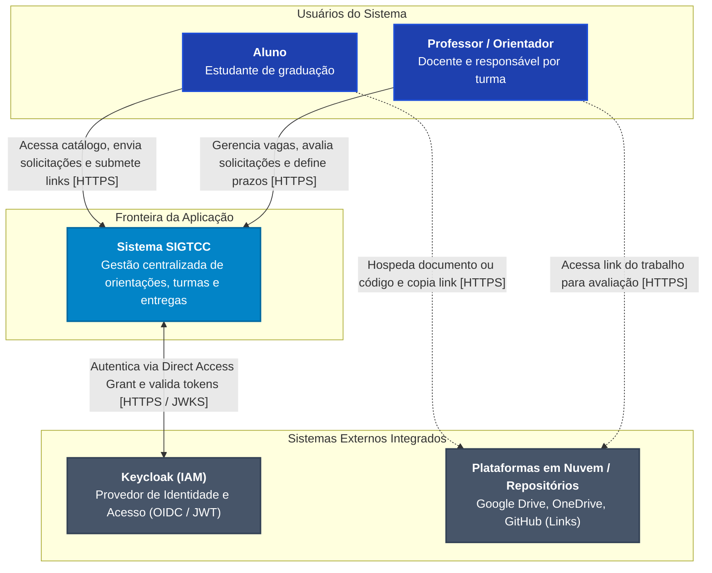
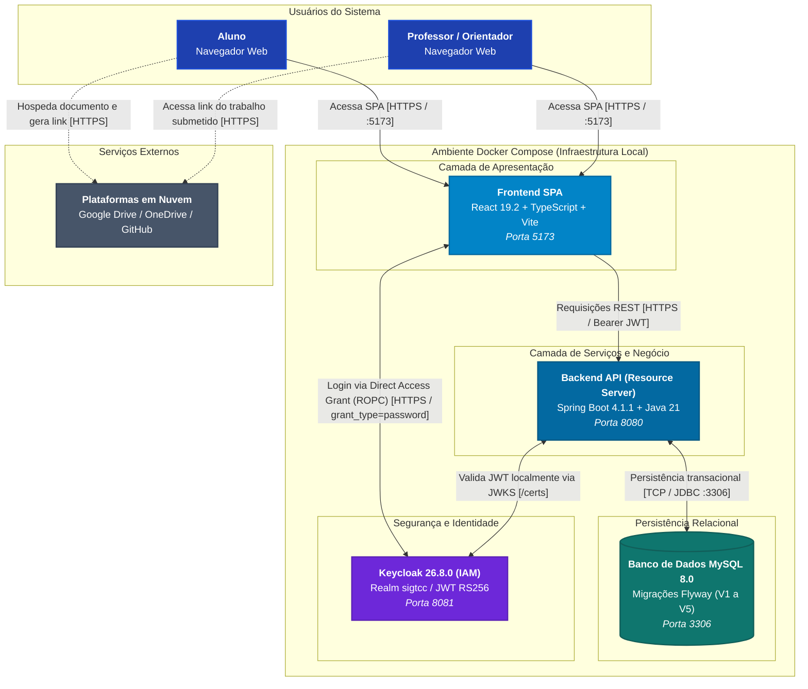

# Documento de Arquitetura do Sistema (SIGTCC)

- **Sistema:** Sistema de Gestão Centralizada de TCC (SIGTCC)
- **Marco de Release:** `v0.3.0` (Sprint 3 – Entrega 7)
- **Responsável Técnica:** Damares do Socorro Gonçalves Gaia (Arquiteta de Software)
- **Data de Consolidação:** Outubro de 2026

---

## 1. Visão Geral e Propósito do Documento

Este documento descreve a arquitetura técnica real e efetivamente implementada do **Sistema de Gestão Centralizada de TCC (SIGTCC)** ao final da Sprint 3. Ele estabelece a organização dos módulos, as responsabilidades de cada contêiner, os padrões de comunicação, os trade-offs de engenharia adotados e a rastreabilidade entre as decisões arquiteturais registradas nas [ADRs](adrs/) e o código em execução.

O SIGTCC é concebido como uma aplicação web desacoplada, composta por:

1. Uma **Single-Page Application (SPA)** em React 19.2 com TypeScript;
2. Uma **API RESTful** em Java 21 com Spring Boot 4.1.1, atuando como Resource Server OAuth2;
3. Um **Banco de Dados Relacional** MySQL 8.0 com evolução de esquema versionada via Flyway (migrações `V1` a `V5`);
4. Um **Provedor de Identidade e Acesso (IAM)** independente em Keycloak 26.8.0.

Todo o ecossistema é orquestrado de forma reproduzível via contêineres Docker Compose.

---

## 2. Diagramas de Arquitetura (Modelo C4)

A arquitetura do SIGTCC é documentada utilizando o **Modelo C4**, refletindo com precisão as fronteiras e integrações em tempo de execução.

### 2.1 Visão de Contexto do Sistema (C1)

A visão de contexto ilustra como os usuários humanos interagem com o SIGTCC e os sistemas externos integrados:

> Diagrama detalhado disponível em: [`docs/diagramas/c1-contexto.md`](diagramas/c1-contexto.md).

---

### 2.2 Visão de Contêineres (C2)

A visão de contêineres apresenta as unidades implantáveis e executáveis em tempo de execução no ambiente Docker:

> Diagrama detalhado disponível em: [`docs/diagramas/c2-conteineres.md`](diagramas/c2-conteineres.md).

---

## 3. Componentes, Responsabilidades, Dependências e Integrações

### 3.1 Frontend (Single-Page Application)

- **Tecnologias:** React 19.2, TypeScript, Vite, React Router DOM, Vitest.
- **Contêiner:** `gestao_tcc_frontend_dev` (Porta externa `5173`).
- **Responsabilidades:**
  - Renderizar a interface de usuário reativa, acessível e responsiva.
  - Implementar o formulário de login reativo próprio (`Login/index.tsx`) integrado ao Keycloak via Direct Access Grant (Resource Owner Password Credentials - ROPC) ([ADR-0014](adrs/ADR-0014.md)).
  - Gerenciar o estado de autenticação centralizado através do `AuthContext.tsx`.
  - Controlar o acesso a rotas públicas e rotas protegidas por permissão (`ROLE_ALUNO`, `ROLE_PROFESSOR`) através do componente guardião `ProtectedRoute.tsx`.
  - Anexar o token de acesso JWT no cabeçalho `Authorization: Bearer <token>` em todas as requisições destinadas à API REST por meio do cliente HTTP centralizado (`api.ts`).
  - Executar validações de formulário no lado do cliente com feedback visual em tempo real e tratamento de erros de credenciais.
- **Dependências e Integrações:**
  - Depende do contêiner `gestao_tcc_backend_dev` para obtenção de dados via requisições HTTP RESTful.
  - Depende do contêiner `gestao_tcc_keycloak_dev` para autenticação via Direct Access Grant no endpoint de token.

### 3.2 Backend (API RESTful e Núcleo de Domínio)

- **Tecnologias:** Java 21, Spring Boot 4.1.1, Spring Security (Resource Server), Spring Data JPA, Hibernate, Flyway, JUnit 5, Mockito.
- **Contêiner:** `gestao_tcc_backend_dev` (Porta externa `8080`).
- **Responsabilidades:**
  - Atuar como **OAuth2 Resource Server** ([ADR-0012](adrs/ADR-0012.md)), validando tokens JWT emitidos pelo Keycloak em memória através do conjunto de chaves públicas carregado via JWKS.
  - Converter a claim `realm_access.roles` do Keycloak em autoridades do Spring (`GrantedAuthority`) através da classe especializada `KeycloakRealmRoleConverter`.
  - Configurar autorização centralizada de rotas na `SecurityConfig` (ex.: `.requestMatchers("/api/v1/professores/**").hasAuthority("ROLE_PROFESSOR")` e `.anyRequest().authenticated()`).
  - Isolar a lógica de apresentação da lógica de domínio em uma arquitetura de camadas bem definida:
    - `controller`: Endpoints REST, tratamento de códigos de resposta HTTP (`200`, `201`, `400`, `404`, `409`, `422`) e mapeamento de DTOs;
    - `service`: Orquestração de regras de negócio e transações gerenciadas (`@Transactional`);
    - `repository`: Interfaces de persistência estendendo `JpaRepository` com consultas especializadas;
    - `model`: Entidades de domínio JPA com integridade relacional estrita;
    - `config`: Configuração de segurança centralizada sem estado (`STATELESS`), política de CORS unificada e conversão de papéis.
  - Aplicar padrões de projeto orientados a objetos ([ADR-0007](adrs/ADR-0007.md)):
    - **Strategy:** Validações desacopladas de elegibilidade de solicitações compostas pela interface `ValidacaoSolicitacaoOrientacao` e suas implementações concretas `ValidacaoVagasDisponiveis`, `ValidacaoOrientadorAtivo` e `ValidacaoSolicitacaoDuplicada`;
    - **Observer:** Disparo e tratamento desacoplado de eventos de mudança de status (`SolicitacaoStatusChangedEvent` consumido por `AtualizadorVagasObserver` para decrementar vagas de forma transacional).
  - Verificar autorização dinâmica de responsabilidade por turma ativa via `TurmaTCCRepository.existsByProfessorResponsavelIdAndVigenteTrue(id)` ([ADR-0010](adrs/ADR-0010.md)).
- **Dependências e Integrações:**
  - Conecta-se ao banco de dados MySQL via JDBC utilizando pool padrão HikariCP gerenciado pelo Spring Boot.
  - Conecta-se ao endpoint JWKS do Keycloak (`http://keycloak:8080/realms/sigtcc/protocol/openid-connect/certs`) para sincronização de chaves criptográficas.

### 3.3 Banco de Dados Relacional

- **Tecnologias:** MySQL 8.0.
- **Contêiner:** `gestao_tcc_db_dev` (Porta externa `3306`).
- **Responsabilidades:**
  - Garantir integridade referencial e persistência transacional com semântica ACID.
  - Executar migrações incrementais estritas via **Flyway** ([ADR-0009](adrs/ADR-0009.md)):
    - `V1__criar_tabelas_iniciais.sql`: Criação das tabelas `usuarios`, `orientadores`, `perfis_professores` e `linhas_pesquisa`;
    - `V2__criar_tabelas_aluno_solicitacao.sql`: Criação da tabela `alunos` (herança de `usuarios`) e da tabela `solicitacoes_orientacao` com chaves estrangeiras para `orientadores` e `alunos`;
    - `V3__criar_tabela_turma_tcc.sql`: Criação da tabela `turmas_tcc` vinculando o período letivo ao `professor_responsavel_id`;
    - `V4__criar_tabela_prazos_entrega.sql`: Criação da tabela `prazos_entrega` definindo datas limite por tipo de entrega vinculadas à turma;
    - `V5__seed_professores_e_turma_vigente.sql`: Carga inicial de dados (seed) de orientadores, perfis, linhas de pesquisa e turma ativa para ambiente de desenvolvimento.
  - Impedir mutações manuais ou não rastreadas de esquema com `hibernate.ddl-auto: validate`.

### 3.4 Provedor de Identidade (Keycloak IAM)

- **Tecnologias:** Keycloak 26.8.0 (Quay.io).
- **Contêiner:** `gestao_tcc_keycloak_dev` (Porta externa `8081`).
- **Responsabilidades:**
  - Centralizar a gestão de contas e autenticação de usuários, isolando credenciais do banco da aplicação.
  - Importar automaticamente o realm `sigtcc` ao inicializar a partir do arquivo versionado `SIGTCC/keycloak/realm-import.json`.
  - Definir o cliente de acesso `sigtcc-frontend` com `directAccessGrantsEnabled: true` para permitir login in-app via Direct Access Grant / ROPC ([ADR-0014](adrs/ADR-0014.md)) e suporte a validação Bearer no backend ([ADR-0012](adrs/ADR-0012.md)).
  - Gerenciar e atribuir os papéis de acesso de primeiro nível: `ROLE_ALUNO` e `ROLE_PROFESSOR`.
  - Emitir tokens de acesso JWT com algoritmo de assinatura assimétrica RS256 e expiração configurada.

---

## 4. Como a Arquitetura Atual Apoia o MVP

A arquitetura foi estruturada para suportar as histórias do escopo priorizado do MVP com alta coesão e baixo acoplamento:

| Funcionalidade do MVP                          | História        | Suporte Arquitetural e Decisões Aplicadas                                                                                                                                                                                                                                                                 |
| :--------------------------------------------- | :-------------- | :-------------------------------------------------------------------------------------------------------------------------------------------------------------------------------------------------------------------------------------------------------------------------------------------------------- |
| **Autenticação e Perfis**                      | **US01**        | Delegada ao Keycloak ([ADR-0011](adrs/ADR-0011.md), [ADR-0014](adrs/ADR-0014.md)). O backend valida localmente os tokens JWT como Resource Server ([ADR-0012](adrs/ADR-0012.md)), eliminando custos de desenvolvimento de fluxos manuais de autenticação e mitigando integralmente o risco R06.           |
| **Cadastro e Edição de Perfil de Orientador**  | **US02**        | Suportada pela hierarquia de entidades JPA (`Usuario` -> `Orientador` -> `PerfilProfessor` -> `LinhaPesquisa`). Operações protegidas com transações declarativas e validações de e-mail institucional único.                                                                                              |
| **Busca e Filtragem de Orientadores**          | **US03**        | Consulta otimizada implementada no repositório (`OrientadorRepository.findByFiltros`), suportando de forma combinada o filtro textual por linha de pesquisa e a restrição booleana por disponibilidade de vagas (`temVagas=true`).                                                                        |
| **Solicitação e Aceite de Orientação (Match)** | **US04**        | Orquestrada com padrões orientados a objetos ([ADR-0007](adrs/ADR-0007.md)). O padrão _Strategy_ avalia as regras de negócio de elegibilidade (vagas, status ativo, ausência de duplicidade), e o padrão _Observer_ garante o decremento transacional de vagas quando o status transiciona para `ACEITA`. |
| **Calendário de Prazos**                       | **US05**        | Viabilizada pela entidade `TurmaTCC` ([ADR-0010](adrs/ADR-0010.md)). A autorização para criação e edição de prazos não depende de um cargo de usuário rígido, mas da verificação de vigência semestral da turma em que o docente atua como responsável.                                                   |
| **Submissão de Entregas e Pareceres**          | **US06 e US07** | Planejadas arquiteturalmente conforme a decisão de submissão por links em nuvem ([ADR-0013](adrs/ADR-0013.md)). O desenho prevê validação e persistência de URLs textuais no backend, dispensando storage físico local e postergando as tabelas e endpoints de submissão para iterações pós-Sprint 3.     |

### Atendimento aos Atributos de Qualidade (ISO/IEC 25010)

- **Manutenibilidade:** Separação estrita em camadas de responsabilidade única, inversão de controle via injeção de dependências do Spring e encapsulamento de regras mutáveis em padrões comportamentais (_Strategy_ e _Observer_).
- **Confiabilidade:** Persistência relacional transacional com validação estrita de esquema via Flyway (`ddl-auto: validate`) e tratamento padronizado de exceções com respostas consistentes via `ErrorResponseDTO`.
- **Segurança:** Isolamento completo de credenciais no Keycloak, tokens JWT efêmeros com assinatura assimétrica RS256, autorização centralizada de rotas na `SecurityConfig` (`ROLE_PROFESSOR`, `ROLE_ALUNO`), proteção de navegação via `ProtectedRoute` no cliente e política de CORS unificada.
- **Portabilidade:** Empacotamento integral da infraestrutura em contêineres Docker padronizados, garantindo paridade de ambiente entre desenvolvimento local e pipelines de CI.

---

## 5. Diferenças Relevantes: Arquitetura Planejada vs. Efetivamente Implementada

Durante a evolução do projeto nas Sprints 1, 2 e 3, a equipe revisou decisões iniciais para adequar a solução aos riscos técnicos observados e aos limites de capacidade do semestre:

| Aspecto Arquitetural                               | Arquitetura Planejada Originalmente (Inception / Sprint 1)                                                                                                                                                                           | Arquitetura Efetivamente Implementada (Sprint 3 / Entrega 7)                                                                                                                                                                                                                                                                                                                                           | Justificativa Técnica da Mudança                                                                                                                                                                                                                     |
| :------------------------------------------------- | :----------------------------------------------------------------------------------------------------------------------------------------------------------------------------------------------------------------------------------- | :----------------------------------------------------------------------------------------------------------------------------------------------------------------------------------------------------------------------------------------------------------------------------------------------------------------------------------------------------------------------------------------------------- | :--------------------------------------------------------------------------------------------------------------------------------------------------------------------------------------------------------------------------------------------------- |
| **Autenticação e Gestão de Usuários**              | Login customizado desenvolvido no backend (Spring Security puro), com armazenamento de senha em `usuarios.senha` e geração manual de JWT ([`docs/inception.md`](inception.md), [`docs/entregas/sprint-2.md`](entregas/sprint-2.md)). | Adoção do **Keycloak 26.8.0** como Provedor de Identidade independente ([ADR-0011](adrs/ADR-0011.md)), backend como **Resource Server OAuth2** ([ADR-0012](adrs/ADR-0012.md)) e autenticação do frontend via **Direct Access Grant (ROPC)** ([ADR-0014](adrs/ADR-0014.md)).                                                                                                                            | Redução de esforço e eliminação do risco de vulnerabilidades em rotinas manuais de senha e sessão. A coluna `senha` na tabela `usuarios` deixou de ser usada na camada de aplicação (ainda existe fisicamente no `V1` e na entidade `Usuario.java`). |
| **Fluxo de Autenticação no Frontend**              | Autenticação via Authorization Code + PKCE com redirecionamento externo para tela hospedada no Keycloak ([ADR-0011](adrs/ADR-0011.md)).                                                                                              | **Planejado PKCE (ADR-0011) → Implementado ROPC (ADR-0014)**: Login por formulário próprio via Direct Access Grant (`grant_type=password`), gerenciado por `AuthContext.tsx`, rotas em `ProtectedRoute.tsx` e Bearer token em `api.ts`.                                                                                                                                                                | Atendimento aos critérios de aceitação da issue #130 (tela de login própria com mensagens de credenciais inválidas em componente React testável), inviabilizados pelo redirecionamento externo do PKCE.                                              |
| **Papéis de Usuário e Gestão Acadêmica**           | Definição de três papéis de usuário rígidos: `Aluno`, `Professor/Orientador` e `Coordenador de TCC` como tipos fixos de cadastro no banco de dados ([`docs/inception.md`](inception.md)).                                            | Perfis de acesso simplificados para **`ROLE_ALUNO`** e **`ROLE_PROFESSOR`**. Introdução da entidade **`TurmaTCC`** ([ADR-0010](adrs/ADR-0010.md)) para controle dinâmico da coordenação da turma no semestre.                                                                                                                                                                                          | Na dinâmica acadêmica, a coordenação da disciplina é um encargo temporário entre docentes. A modelagem dinâmica de `TurmaTCC` preserva a rastreabilidade histórica de períodos anteriores sem corromper o cadastro vitalício do docente.             |
| **Submissão de Documentos de TCC**                 | Upload físico de arquivos multipart (PDFs de Projeto, TCC 1 e TCC 2) persistidos em volume de disco do servidor ([`docs/inception.md`](inception.md)).                                                                               | **Submissão por links externos** em plataformas de nuvem colaborativas ou repositórios de código ([ADR-0013](adrs/ADR-0013.md)), validando URLs HTTPS no backend.                                                                                                                                                                                                                                      | Eliminação da sobrecarga de gerenciar infraestrutura de storage local, quotas de disco e riscos de binários maliciosos, permitindo que a revisão ocorra diretamente com comentários e anotações nativas nas plataformas de nuvem.                    |
| **Evolução do Esquema do Banco de Dados**          | Criação e atualização automática de tabelas gerenciada pelo Hibernate com `hibernate.ddl-auto: update` (prática inicial da Sprint 1).                                                                                                | Controle formal e incremental de esquema via migrações versionadas do **Flyway** (`V1` a `V5`), com validação estrita em runtime (`hibernate.ddl-auto: validate`) ([ADR-0009](adrs/ADR-0009.md)). Tabelas criadas: `V1` (`usuarios`, `orientadores`, `perfis_professores`, `linhas_pesquisa`), `V2` (`alunos`, `solicitacoes_orientacao`), `V3` (`turmas_tcc`), `V4` (`prazos_entrega`) e `V5` (seed). | Prevenção de corrupção silenciosa de dados e inconsistências estruturais entre os ambientes de desenvolvimento da equipe e o pipeline de CI.                                                                                                         |
| **Composição de Regras de Negócio de Solicitação** | Serviços procedurais baseados em encadeamentos de condicionais `if/else` no `SolicitacaoService`.                                                                                                                                    | Aplicação dos padrões comportamentais **Strategy** (validações de elegibilidade independentes) e **Observer** (atualização reativa e transacional de vagas) ([ADR-0007](adrs/ADR-0007.md)).                                                                                                                                                                                                            | Aderência aos princípios SOLID (Aberto/Fechado e Responsabilidade Única), aumentando a testabilidade com testes unitários isolados por estratégia.                                                                                                   |

---

## 6. Rastreabilidade com as Decisões Arquiteturais (ADRs)

Todas as escolhas estruturais do projeto estão registradas e justificadas formalmente nas Decisões Arquiteturais da equipe:

| Código                         | Título                                                                                             |  Status  | Componente Impactado |
| :----------------------------- | :------------------------------------------------------------------------------------------------- | :------: | :------------------- |
| [`ADR-0001`](adrs/ADR-0001.md) | Seleção de Stack Backend - Java 21+ e Spring Boot 4                                                | Aprovada | Backend              |
| [`ADR-0002`](adrs/ADR-0002.md) | Tipo de Aplicação - Aplicação Web Responsiva                                                       | Aprovada | Sistema Global       |
| [`ADR-0003`](adrs/ADR-0003.md) | Arquitetura em Camadas (Layered Architecture) para o Backend                                       | Aprovada | Backend              |
| [`ADR-0004`](adrs/ADR-0004.md) | Seleção de Banco de Dados Relacional - MySQL 8.0 e Spring Data JPA                                 | Aprovada | Banco de Dados       |
| [`ADR-0005`](adrs/ADR-0005.md) | Padronização de Ambientes de Desenvolvimento e Execução com Docker                                 | Aprovada | Infraestrutura       |
| [`ADR-0006`](adrs/ADR-0006.md) | Seleção de Stack Frontend - React com TypeScript                                                   | Aprovada | Frontend             |
| [`ADR-0007`](adrs/ADR-0007.md) | Aplicação dos Padrões de Projeto Strategy e Observer na US04                                       | Aprovada | Backend / Domínio    |
| [`ADR-0008`](adrs/ADR-0008.md) | Modelagem da Entidade Aluno Desacoplada de Autenticação para Reutilização na US01                  | Aprovada | Backend / Domínio    |
| [`ADR-0009`](adrs/ADR-0009.md) | Adoção do Flyway para Versionamento e Migrações do Banco de Dados                                  | Aprovada | Banco de Dados       |
| [`ADR-0010`](adrs/ADR-0010.md) | Modelagem da Entidade Turma_TCC e Vínculo com Professor Responsável                                | Aprovada | Backend / Domínio    |
| [`ADR-0011`](adrs/ADR-0011.md) | Adoção do Keycloak para Autenticação e Gestão de Identidades (IAM)                                 | Aprovada | Infraestrutura / IAM |
| [`ADR-0012`](adrs/ADR-0012.md) | Backend como Resource Server OAuth2 com Validação Local de JWT                                     | Aprovada | Backend / Segurança  |
| [`ADR-0013`](adrs/ADR-0013.md) | Adoção de Submissão por Link Externo em Substituição ao Upload Físico                              | Aprovada | Backend / Frontend   |
| [`ADR-0014`](adrs/ADR-0014.md) | Autenticação do Frontend via Direct Access Grant (Resource Owner Password Credentials) do Keycloak | Aprovada | Frontend / IAM       |
