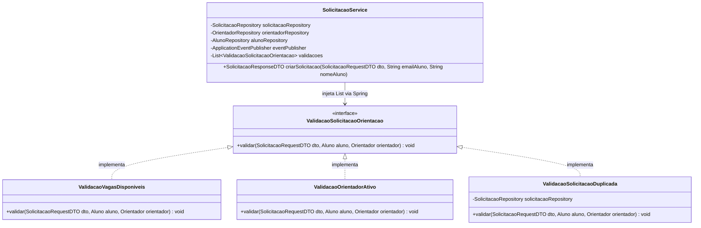
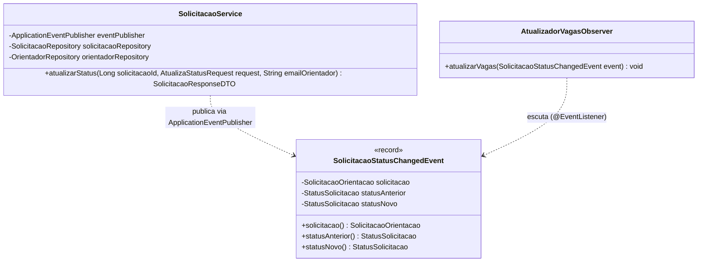
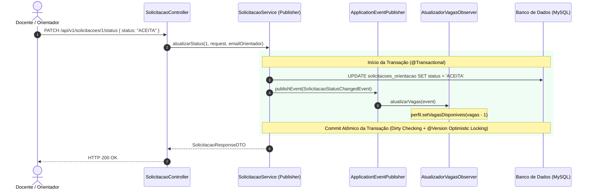

# Documento de Arquitetura: Aplicação de Padrões de Projeto OO na US04

> **SIGTCC - Sistema de Gestão Centralizada de TCC**  
> **Artefato:** `docs/PADROES-DE-PROJETO.md`  
> **Autora:** Damares Gaia (Scrum Master da Sprint 2 & Arquiteta de Software)  
> **Status:** Aprovado e Consolidado com a Implementação  
> **Rastreabilidade:** Issue #11 (US04), Issue #91 (Doc-1 / ADRs), Issue #92 (Doc-2), Issue #83 (Backend Strategy), Issue #84 (Backend Observer), Issue #152 (Consolidação Arquitetural)

---

## 1. Introdução e Motivação Arquitetural

No ciclo de desenvolvimento da **Sprint 2 (marco da US04 - Solicitação e Aceite de Orientação)**, a equipe de engenharia identificou desafios arquiteturais críticos na modelagem da camada de negócio do backend:

1. **Validações de Elegibilidade Variáveis e Expansíveis:** A criação de uma solicitação de orientação exige múltiplas checagens de negócio (capacidade de vagas do orientador, orientador ativo e ausência de solicitação pendente duplicada para o mesmo discente). Concentrar essas checagens em cadeias imperativas de `if/else` dentro de um único serviço viola o princípio **Aberto/Fechado (OCP - _Open/Closed Principle_)**, gerando uma classe inflada (_God Class_) de manutenção arriscada.
2. **Desacoplamento de Reações na Mudança de Estado:** Quando uma solicitação transita para o status `ACEITA`, efeitos colaterais imediatos precisam ser disparados (especificamente o decremento atômico de vaga ofertada pelo orientador). Acoplar essa manipulação diretamente no método de transição do serviço viola o princípio da **Responsabilidade Única (SRP - _Single Responsibility Principle_)**.

Para resolver esses desafios com rigor técnico, foram formalizadas as decisões na [**`ADR-0007`**](./adrs/ADR-0007.md), adotando dois padrões de projeto clássicos do _Gang of Four (GoF)_: **Strategy** e **Observer**.

Este documento especifica a estrutura de classes, os contratos de interfaces e os diagramas de interação correspondentes à implementação real do backend.

---

## 2. Padrão Strategy (Validações de Elegibilidade da US04)

### 2.1 Problema Resolvido

No fluxo `POST /api/v1/solicitacoes`, cada regra de elegibilidade de domínio possui critérios de checagem e exceções semânticas distintas:

- Orientador sem vagas -> erro HTTP 422 (`VagasIndisponiveisException`);
- Orientador inativo -> erro HTTP 422 (`OrientadorInativoException`);
- Solicitação pendente já existente para o mesmo discente e orientador -> erro HTTP 409 (`SolicitacaoDuplicadaException`).

_(Nota: validações sintáticas de campos obrigatórios como `orientadorId`, `curso`, `tema` e `mensagem` são tratadas na fronteira de entrada via Jakarta Bean Validation no `SolicitacaoRequestDTO`, retornando HTTP 400)._

O padrão **Strategy** (aplicado como composição polimórfica de validadores de negócio) encapsula cada regra de elegibilidade em uma classe especialista independente, permitindo adicionar, alterar ou remover regras sem modificar o código do `SolicitacaoService`.

### 2.2 Diagrama de Classes (Strategy)



### 2.3 Estrutura de Pacotes e Nomenclatura

Os componentes estão organizados no pacote `validation`:

```
br.edu.ifsc.gestao_tcc.validation/
├── ValidacaoSolicitacaoOrientacao.java   (Interface base da estratégia de validação)
├── ValidacaoVagasDisponiveis.java        (Regra de cota de vagas > 0)
├── ValidacaoOrientadorAtivo.java         (Regra de orientador ativo no sistema)
└── ValidacaoSolicitacaoDuplicada.java    (Regra de duplicidade aluno-orientador)
```

### 2.4 Contratos de Interface e Implementação Real

#### Interface Central (`ValidacaoSolicitacaoOrientacao.java`)

```java
package br.edu.ifsc.gestao_tcc.validation;

import br.edu.ifsc.gestao_tcc.dto.SolicitacaoRequestDTO;
import br.edu.ifsc.gestao_tcc.model.Aluno;
import br.edu.ifsc.gestao_tcc.model.Orientador;

public interface ValidacaoSolicitacaoOrientacao {
    void validar(SolicitacaoRequestDTO dto, Aluno aluno, Orientador orientador);
}
```

#### Estratégia de Vagas Disponíveis (`ValidacaoVagasDisponiveis.java`)

```java
package br.edu.ifsc.gestao_tcc.validation;

import br.edu.ifsc.gestao_tcc.dto.SolicitacaoRequestDTO;
import br.edu.ifsc.gestao_tcc.exception.VagasIndisponiveisException;
import br.edu.ifsc.gestao_tcc.model.Aluno;
import br.edu.ifsc.gestao_tcc.model.Orientador;
import org.springframework.stereotype.Component;

@Component
public class ValidacaoVagasDisponiveis implements ValidacaoSolicitacaoOrientacao {

    @Override
    public void validar(SolicitacaoRequestDTO dto, Aluno aluno, Orientador orientador) {
        if (orientador.getPerfil() == null || orientador.getPerfil().getVagasDisponiveis() <= 0) {
            throw new VagasIndisponiveisException("O orientador não possui vagas disponíveis.");
        }
    }
}
```

#### Estratégia de Orientador Ativo (`ValidacaoOrientadorAtivo.java`)

```java
package br.edu.ifsc.gestao_tcc.validation;

import br.edu.ifsc.gestao_tcc.dto.SolicitacaoRequestDTO;
import br.edu.ifsc.gestao_tcc.exception.OrientadorInativoException;
import br.edu.ifsc.gestao_tcc.model.Aluno;
import br.edu.ifsc.gestao_tcc.model.Orientador;
import org.springframework.stereotype.Component;

@Component
public class ValidacaoOrientadorAtivo implements ValidacaoSolicitacaoOrientacao {

    @Override
    public void validar(SolicitacaoRequestDTO dto, Aluno aluno, Orientador orientador) {
        if (orientador.getAtivo() == null || !orientador.getAtivo()) {
            throw new OrientadorInativoException("O orientador não está disponível para receber solicitações.");
        }
    }
}
```

#### Estratégia de Duplicidade (`ValidacaoSolicitacaoDuplicada.java`)

```java
package br.edu.ifsc.gestao_tcc.validation;

import br.edu.ifsc.gestao_tcc.dto.SolicitacaoRequestDTO;
import br.edu.ifsc.gestao_tcc.exception.SolicitacaoDuplicadaException;
import br.edu.ifsc.gestao_tcc.model.Aluno;
import br.edu.ifsc.gestao_tcc.model.Orientador;
import br.edu.ifsc.gestao_tcc.model.StatusSolicitacao;
import br.edu.ifsc.gestao_tcc.repository.SolicitacaoRepository;
import lombok.RequiredArgsConstructor;
import org.springframework.stereotype.Component;

@Component
@RequiredArgsConstructor
public class ValidacaoSolicitacaoDuplicada implements ValidacaoSolicitacaoOrientacao {

    private final SolicitacaoRepository solicitacaoRepository;

    @Override
    public void validar(SolicitacaoRequestDTO dto, Aluno aluno, Orientador orientador) {
        boolean existeSolicitacaoPendente = solicitacaoRepository.existsByAlunoIdAndOrientadorIdAndStatus(
                aluno.getId(), orientador.getId(), StatusSolicitacao.PENDENTE);

        if (existeSolicitacaoPendente) {
            throw new SolicitacaoDuplicadaException("Você possui uma solicitação pendente para este orientador.");
        }
    }
}
```

#### Injeção e Execução no `SolicitacaoService`

```java
@Service
@RequiredArgsConstructor
public class SolicitacaoService {

    private final SolicitacaoRepository solicitacaoRepository;
    private final OrientadorRepository orientadorRepository;
    private final AlunoRepository alunoRepository;
    private final ApplicationEventPublisher eventPublisher;
    private final List<ValidacaoSolicitacaoOrientacao> validacoes;

    @Transactional
    public SolicitacaoResponseDTO criarSolicitacao(SolicitacaoRequestDTO dto, String emailAluno, String nomeAluno) {
        Orientador orientador = orientadorRepository.findById(dto.getOrientadorId())
                .orElseThrow(() -> new ResourceNotFoundException(
                        "Orientador com identificador " + dto.getOrientadorId() + " não foi encontrado."));

        Aluno aluno = alunoRepository.findByEmail(emailAluno)
                .orElseGet(() -> alunoRepository.save(Aluno.builder()
                        .nome(nomeAluno == null || nomeAluno.isBlank() ? emailAluno : nomeAluno.trim())
                        .email(emailAluno)
                        .curso(dto.getCurso().trim())
                        .build()));

        validacoes.forEach(validacao -> validacao.validar(dto, aluno, orientador));

        SolicitacaoOrientacao solicitacao = SolicitacaoOrientacao.builder()
                .orientador(orientador)
                .aluno(aluno)
                .tema(dto.getTema())
                .mensagem(dto.getMensagem())
                .status(StatusSolicitacao.PENDENTE)
                .build();

        return toResponse(solicitacaoRepository.save(solicitacao));
    }
}
```

### 2.5 Testabilidade Unitária Isolada (Sem Contexto Spring)

O padrão Strategy viabiliza testes unitários rápidos e 100% isolados utilizando apenas JUnit 5 e Mockito:

```java
class ValidacaoVagasDisponiveisTest {

    private final ValidacaoVagasDisponiveis validacao = new ValidacaoVagasDisponiveis();

    @Test
    void deveLancarExcecaoQuandoVagasForemZero() {
        Orientador orientador = new Orientador();
        PerfilOrientador perfil = new PerfilOrientador();
        perfil.setVagasDisponiveis(0);
        orientador.setPerfil(perfil);

        assertThrows(VagasIndisponiveisException.class,
                () -> validacao.validar(new SolicitacaoRequestDTO(), new Aluno(), orientador));
    }
}
```

### 2.6 Benefícios do Padrão Strategy

- **Aderência aos princípios OCP e SRP:** Novas regras de validação podem ser introduzidas adicionando novas classes que implementam `ValidacaoSolicitacaoOrientacao`, sem modificar o código do `SolicitacaoService`.
- **Alta testabilidade:** Cada regra possui testes unitários isolados, rápidos e sem dependência do contexto Spring.

### 2.7 Trade-offs e Mitigações

- **Proliferação de classes:** Introduz múltiplas classes e interfaces pequenas para regras simples.
  - _Mitigação Adotada:_ Agrupamento no pacote coeso `br.edu.ifsc.gestao_tcc.validation` com nomenclatura padronizada e papéis bem definidos.
- **Sobrecarga de injeção em runtime:** O Spring gerencia a injeção da lista de estratégias.
  - _Mitigação Adotada:_ Como são componentes leves anotados com `@Component`, a injeção ocorre apenas na inicialização da aplicação, com impacto nulo na latência das requisições.

---

## 3. Padrão Observer (Transição de Status e Efeitos Colaterais)

### 3.1 Problema Resolvido

No endpoint `PATCH /api/v1/solicitacoes/{id}/status`, o orientador destinatário atualiza o estado da solicitação para `ACEITA` ou `RECUSADA`.
Ao transitar para `ACEITA`:

- A cota de vagas do orientador deve ser decrementada em 1 no seu perfil associado (`vagasDisponiveis = vagasDisponiveis - 1`).

Se essa operação de decremento for acoplada diretamente no fluxo transacional do `SolicitacaoService`, cria-se acoplamento entre domínios distintos e violação do princípio da Responsabilidade Única (SRP).

O padrão **Observer** resolve essa questão publicando o evento de domínio `SolicitacaoStatusChangedEvent` via `ApplicationEventPublisher`. O Spring Boot despacha o evento para o ouvinte cadastrado (`AtualizadorVagasObserver`), mantendo a máquina de estados da solicitação isolada da manipulação das cotas de vagas do orientador.

### 3.2 Diagrama de Classes e Sequência (Observer)

#### Diagrama de Classes



#### Diagrama de Sequência



### 3.3 Classes e Módulos Afetados (Estrutura de Pacotes)

Os componentes da solução estão organizados nos seguintes pacotes:

```
br.edu.ifsc.gestao_tcc/
├── event/
│   └── SolicitacaoStatusChangedEvent.java   (Record do Evento de Domínio)
└── observer/
    └── AtualizadorVagasObserver.java        (Listener síncrono transacional de vagas)
```

### 3.4 Contratos e Implementação Real

#### Evento de Domínio (`SolicitacaoStatusChangedEvent.java`)

```java
package br.edu.ifsc.gestao_tcc.event;

import br.edu.ifsc.gestao_tcc.model.SolicitacaoOrientacao;
import br.edu.ifsc.gestao_tcc.model.StatusSolicitacao;

public record SolicitacaoStatusChangedEvent(
        SolicitacaoOrientacao solicitacao,
        StatusSolicitacao statusAnterior,
        StatusSolicitacao statusNovo
) {
}
```

#### Observador de Vagas (`AtualizadorVagasObserver.java`)

```java
package br.edu.ifsc.gestao_tcc.observer;

import br.edu.ifsc.gestao_tcc.event.SolicitacaoStatusChangedEvent;
import br.edu.ifsc.gestao_tcc.model.PerfilOrientador;
import br.edu.ifsc.gestao_tcc.model.StatusSolicitacao;
import org.springframework.context.event.EventListener;
import org.springframework.stereotype.Component;

@Component
public class AtualizadorVagasObserver {

    @EventListener
    public void atualizarVagas(SolicitacaoStatusChangedEvent event) {
        if (event.statusNovo() != StatusSolicitacao.ACEITA) {
            return;
        }

        PerfilOrientador perfil = event.solicitacao()
                .getOrientador()
                .getPerfil();

        perfil.setVagasDisponiveis(perfil.getVagasDisponiveis() - 1);
    }
}
```

#### Publicação no `SolicitacaoService`

```java
@Transactional
public SolicitacaoResponseDTO atualizarStatus(
        Long solicitacaoId, AtualizaStatusRequest request, String emailOrientador) {
    SolicitacaoOrientacao solicitacao = solicitacaoRepository.findById(solicitacaoId)
            .orElseThrow(() -> new ResourceNotFoundException(
                    "Solicitação com identificador " + solicitacaoId + " não foi encontrada."));

    validarOrientadorDestinatario(solicitacao.getOrientador(), emailOrientador);

    if (solicitacao.getStatus() != StatusSolicitacao.PENDENTE) {
        throw new SolicitacaoJaRespondidaException("Esta solicitação foi respondida e não pode ser alterada.");
    }

    StatusSolicitacao statusAnterior = solicitacao.getStatus();
    StatusSolicitacao novoStatus = request.status();

    if (novoStatus == StatusSolicitacao.ACEITA) {
        validarVagasDisponiveis(solicitacao.getOrientador());
        solicitacao.setStatus(StatusSolicitacao.ACEITA);
        solicitacao.setJustificativa(null);
    } else {
        validarJustificativa(request.justificativa());
        solicitacao.setStatus(StatusSolicitacao.RECUSADA);
        solicitacao.setJustificativa(request.justificativa().trim());
    }

    solicitacaoRepository.save(solicitacao);

    eventPublisher.publishEvent(new SolicitacaoStatusChangedEvent(solicitacao, statusAnterior, novoStatus));

    return toResponse(solicitacao);
}
```

### 3.5 Benefícios do Padrão Observer

- **Desacoplamento de domínio:** O `SolicitacaoService` não manipula diretamente a atualização da contagem de vagas do perfil docente.
- **Responsabilidade Única (SRP):** O serviço foca na validação da máquina de estados da solicitação, enquanto o observador reage à transição.
- **Extensibilidade controlada:** Permite que no futuro outros observadores internos (como auditoria em log ou métricas) sejam acoplados como novos `@EventListener` sem alterar o método transacional.

### 3.6 Trade-offs e Mitigações da Implementação Real

- **Consistência Transacional vs. Execução Assíncrona:** A execução assíncrona (`@Async`) poderia causar inconsistência (ex.: a solicitação é aceita no banco, mas a thread de atualização de vagas falha).
  - _Mitigação Adotada:_ Utilização de listener **estritamente síncrono** (`@EventListener` padrão do Spring) dentro do mesmo contexto `@Transactional`. Como a entidade `Orientador` e seu `PerfilOrientador` já estão carregados na sessão do Hibernate, a dedução de vagas ocorre em memória e é persistida via _dirty checking_ no _commit_ atômico da transação.
- **Condição de Corrida no Consumo de Vagas (Concorrência):** Em cenários de concorrência (dois aceites simultâneos disputando a última vaga do orientador), apenas `@Transactional` não impede que duas transações leiam o mesmo saldo de vagas antes do _commit_.
  - _Mitigação Adotada:_ Adoção de **bloqueio otimista (_Optimistic Locking_)** na entidade `PerfilOrientador` via anotação `@Version` do Jakarta Persistence (`private Long versao`, suportada pela coluna `versao` introduzida na migração `V8__adicionar_versao_perfil_orientador.sql`). Caso duas transações concorrentes tentem atualizar o mesmo perfil simultaneamente, o Hibernate detecta a divergência de versão no _flush/commit_ e lança `OptimisticLockingFailureException`, convertida pelo `GlobalExceptionHandler` em `HTTP 409 Conflict` (`ErrorResponseDTO`).
- **Ausência de Notificações Ativas:** Conforme pactuado na governança da Sprint 2 e na [ADR-0007](./adrs/ADR-0007.md), **não foram implementadas notificações ativas** (como disparos externos de e-mail ou mensageria assíncrona). O painel do orientador opera exclusivamente por consulta sob demanda (_pull model_ via `GET /api/v1/solicitacoes/orientador/{id}?status=PENDENTE`), eliminando custos de infraestrutura no MVP.

---

## 4. Matriz de Trade-offs e Boas Práticas

| Padrão       | Vantagens Arquiteturais                                                                                                                                                        | Desvantagens / Trade-offs                                                                                                      | Mitigação Adotada                                                                                                                                                                                                                                     |
| :----------- | :----------------------------------------------------------------------------------------------------------------------------------------------------------------------------- | :----------------------------------------------------------------------------------------------------------------------------- | :---------------------------------------------------------------------------------------------------------------------------------------------------------------------------------------------------------------------------------------------------- |
| **Strategy** | - Respeito integral ao OCP e SRP.<br>- Adição de regras via novas classes `@Component`.<br>- Testes unitários com JUnit 5 puros.                                               | - Maior quantidade de classes e interfaces no pacote.                                                                          | Organização em pacote coeso (`validation`) com contratos claros.                                                                                                                                                                                      |
| **Observer** | - Desacoplamento entre o fluxo principal da solicitação e os efeitos colaterais.<br>- Extensibilidade para plugar novos ouvintes no futuro sem alterar o serviço transacional. | - Risco de perda de atomicidade se os ouvintes rodarem de forma assíncrona.<br>- Disputa concorrente pela última vaga em alta. | Uso de **`@EventListener` síncrono transacional** combinado com **bloqueio otimista (`@Version`)** em `PerfilOrientador` (`V8`), garantindo atomicidade e rejeitando conflitos concorrentes com `409 Conflict` (`OptimisticLockingFailureException`). |

---

## 5. Rastreabilidade com Backlog e Contratos

Este design arquitetural atende e orienta diretamente as entregas da US04:

- **Issue #11 (US04 - Solicitação e Aceite de Orientação):** História de usuário macro;
- **Issue #91 (Doc-1 - ADR-0007 e ADR-0008):** Formalização das decisões arquiteturais;
- **Issue #92 (Doc-2 - docs/PADROES-DE-PROJETO.md):** Esta especificação técnica;
- **Issue #83 (`[Backend] Validações (Strategy) + POST /solicitacoes`):** Implementação das classes do pacote `validation`;
- **Issue #84 (`[Backend] Aceitar/Recusar (Observer) + listagem de pendentes`):** Implementação das classes dos pacotes `event` e `observer`.

---

## 6. Referências

- Gamma, E., Helm, R., Johnson, R., Vlissides, J. (1994). _Design Patterns: Elements of Reusable Object-Oriented Software_. Addison-Wesley.
- Refactoring Guru: [Strategy Pattern](https://refactoring.guru/design-patterns/strategy) e [Observer Pattern](https://refactoring.guru/design-patterns/observer).
- Spring Framework Documentation: [Application Events and Listeners](https://docs.spring.io/spring-framework/reference/core/beans/context-introduction.html#context-functionality-events).
- Decisão Arquitetural: [`docs/adrs/ADR-0007.md`](./adrs/ADR-0007.md).
- Contrato de Dados da API: [`docs/contrato-dados-us04.md`](./contrato-dados-us04.md).
