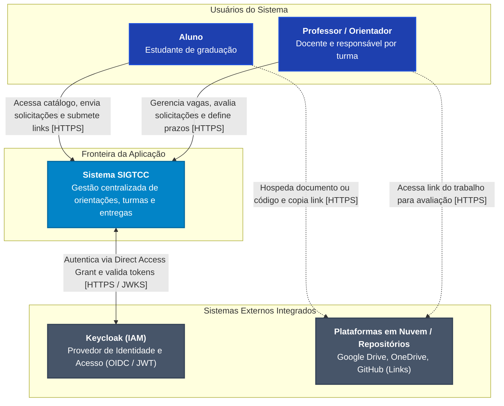

# Diagrama de Arquitetura: Visão de Contexto (C1)

Este documento apresenta a **Visão de Contexto (Nível 1 do modelo C4)** do **Sistema de Gestão Centralizada de TCC (SIGTCC)**, destacando os atores humanos do sistema, as fronteiras da aplicação e os sistemas externos com os quais interage.

---

## 1. Diagrama de Contexto (C1)

---

## 2. Descrição dos Elementos

### 2.1 Atores (Pessoas)

| Elemento                   | Tipo           | Descrição e Responsabilidades                                                                                                                                                                                                                                                                                            |
| :------------------------- | :------------- | :----------------------------------------------------------------------------------------------------------------------------------------------------------------------------------------------------------------------------------------------------------------------------------------------------------------------- |
| **Aluno**                  | Usuário Humano | Utiliza a interface web para buscar orientadores por linha de pesquisa e disponibilidade de vagas, formalizar solicitação de orientação (US04), acompanhar o parecer do docente e submeter links de entregas do calendário (conforme [ADR-0013](../adrs/ADR-0013.md)).                                                   |
| **Professor / Orientador** | Usuário Humano | Cadastra e edita seu perfil de orientador e vagas (US02), aceita ou recusa solicitações de orientação com justificativa (US04) e, caso seja o professor responsável pela `Turma_TCC` no semestre vigente (conforme [ADR-0010](../adrs/ADR-0010.md)), define e edita os prazos de entrega do calendário acadêmico (US05). |

### 2.2 Sistema Central

| Elemento   | Tipo                | Descrição e Responsabilidades                                                                                                                                                                                                                                                                                            |
| :--------- | :------------------ | :----------------------------------------------------------------------------------------------------------------------------------------------------------------------------------------------------------------------------------------------------------------------------------------------------------------------- |
| **SIGTCC** | Sistema de Software | Aplicação web desenvolvida para centralizar a governança do fluxo de TCC. Elimina a dispersão de comunicação via e-mail e aplicativos de mensagens, provendo catálogo de docentes, regras desacopladas de elegibilidade e atualização de vagas (Strategy/Observer), governança semestral de turmas e controle de prazos. |

### 2.3 Sistemas Externos Integrados

| Elemento                                | Tipo                   | Descrição e Responsabilidades                                                                                                                                                                                                                                                                                                                                                                  |
| :-------------------------------------- | :--------------------- | :--------------------------------------------------------------------------------------------------------------------------------------------------------------------------------------------------------------------------------------------------------------------------------------------------------------------------------------------------------------------------------------------- |
| **Keycloak (IAM)**                      | Provedor de Identidade | Servidor de autenticação independente executado em contêiner Docker dedicado (`gestao_tcc_keycloak_dev`, porta `8081`). Centraliza o armazenamento de credenciais, gerenciamento do realm `sigtcc` e emissão de tokens de acesso JWT com papéis `ROLE_ALUNO` e `ROLE_PROFESSOR` (conforme [ADR-0011](../adrs/ADR-0011.md), [ADR-0012](../adrs/ADR-0012.md) e [ADR-0014](../adrs/ADR-0014.md)). |
| **Plataformas em Nuvem / Repositórios** | Armazenamento Externo  | Serviços como Google Drive, OneDrive ou GitHub onde os alunos mantêm seus artefatos textuais e bases de código. O sistema armazena apenas as URLs validadas, eliminando a custódia de binários no backend (conforme [ADR-0013](../adrs/ADR-0013.md)).                                                                                                                                          |
