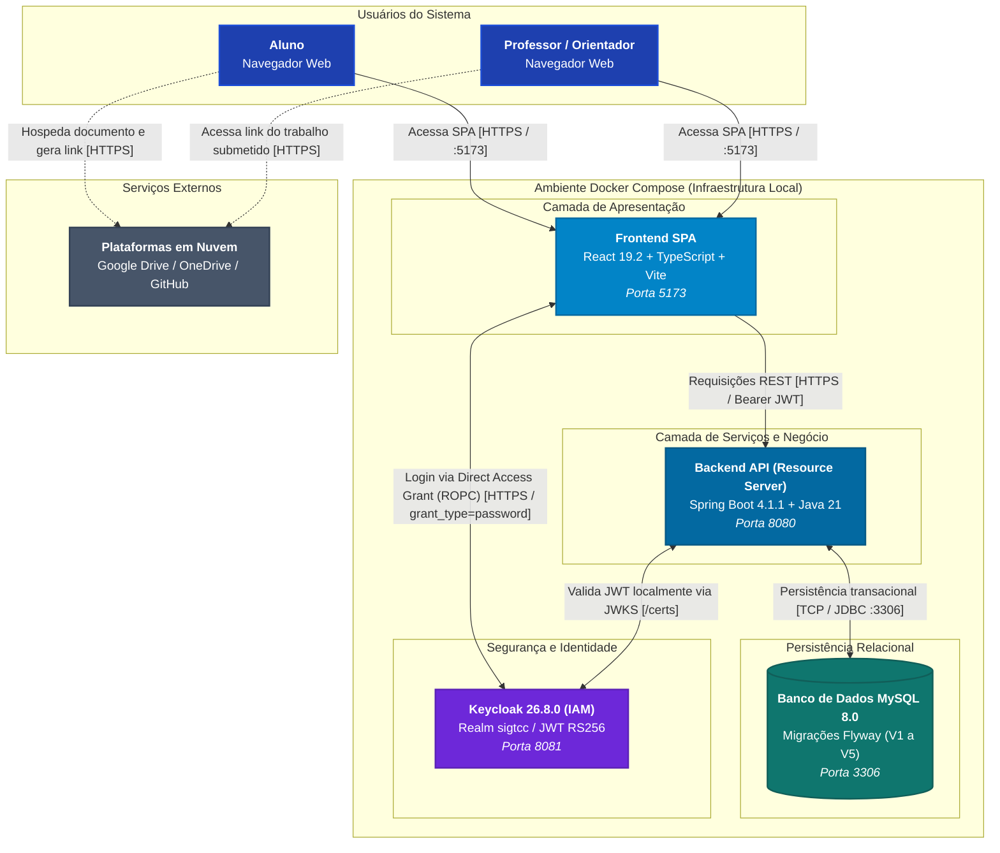

# Diagrama de Arquitetura: Visão de Contêineres (C2)

Este documento apresenta a **Visão de Contêineres (Nível 2 do modelo C4)** do **Sistema de Gestão Centralizada de TCC (SIGTCC)**, ilustrando as aplicações executáveis, armazenamentos de dados, protocolos de comunicação e como as fronteiras arquiteturais se organizam em tempo de execução no ambiente Docker.

---

## 1. Diagrama de Contêineres (C2)

---

## 2. Detalhamento dos Contêineres

| Contêiner          | Tecnologias Principais                                       | Mapeamento de Portas | Responsabilidade Principal                                                                                                                                                                                                                                                                                                                                                                                                                                     |
| :----------------- | :----------------------------------------------------------- | :------------------- | :------------------------------------------------------------------------------------------------------------------------------------------------------------------------------------------------------------------------------------------------------------------------------------------------------------------------------------------------------------------------------------------------------------------------------------------------------------- |
| **Frontend SPA**   | React 19.2, TypeScript, Vite                                 | `5173:5173`          | Interface de usuário do tipo Single-Page Application. Gerencia rotas protegidas por papel (`ROLE_ALUNO`, `ROLE_PROFESSOR`) via `ProtectedRoute.tsx`, formulário de login reativo próprio (`Login/index.tsx`) gerenciado por `AuthContext.tsx` via Direct Access Grant ([ADR-0014](../adrs/ADR-0014.md)) e comunicação com a API REST anexando o token JWT no cabeçalho `Authorization: Bearer <token>` através do cliente HTTP centralizado (`api.ts`).        |
| **Backend API**    | Java 21, Spring Boot 4.1.1, Spring Security, Spring Data JPA | `8080:8080`          | Camada de serviços e regras de negócio. Configurado como **OAuth2 Resource Server** ([ADR-0012](../adrs/ADR-0012.md)), validando assinaturas e claims dos tokens JWT emitidos pelo Keycloak em memória via conjunto de chaves públicas (`JWKS`). Aplica regras desacopladas de elegibilidade com _Strategy_ e atualização de vagas com _Observer_ ([ADR-0007](../adrs/ADR-0007.md)), além de controlar a vigência de turmas ([ADR-0010](../adrs/ADR-0010.md)). |
| **Banco de Dados** | MySQL 8.0                                                    | `3306:3306`          | Persistência relacional com evolução de esquema versionada via migrações Flyway (`V1` a `V5`). Armazena tabelas `usuarios`, `orientadores`, `perfis_professores`, `linhas_pesquisa`, `alunos`, `solicitacoes_orientacao`, `turmas_tcc`, `prazos_entrega` e carga inicial de dados via seed.                                                                                                                                                                    |
| **Keycloak (IAM)** | Keycloak 26.8.0                                              | `8081:8080`          | Provedor de Identidade centralizado ([ADR-0011](../adrs/ADR-0011.md), [ADR-0014](../adrs/ADR-0014.md)). Executado com o parâmetro `--import-realm` carregando as definições de `SIGTCC/keycloak/realm-import.json`. Gerencia usuários, credenciais seguras e emite tokens de acesso no formato JWT contendo os papéis `ROLE_ALUNO` e `ROLE_PROFESSOR`.                                                                                                         |

---

## 3. Protocolos e Integrações entre Contêineres

1. **Autenticação e Obtenção de Token (Frontend ↔ Keycloak):**
   - O usuário submete suas credenciais diretamente no formulário de login in-app da SPA (`Login/index.tsx`), gerenciado pelo `AuthContext.tsx`.
   - A aplicação envia uma requisição `POST` com `grant_type=password` ao endpoint `/protocol/openid-connect/token` do Keycloak (Direct Access Grant / ROPC conforme [ADR-0014](../adrs/ADR-0014.md)).
   - Após validação das credenciais com sucesso, o Keycloak retorna o token de acesso (JWT) contendo o claim `realm_access.roles`. O token é gerenciado na sessão da aplicação e propagado automaticamente nas requisições pelo cliente HTTP centralizado (`api.ts`), com permissões de acesso validadas por `ProtectedRoute.tsx`.
2. **Requisições de Domínio (Frontend ↔ Backend):**
   - As chamadas aos endpoints REST (`/api/v1/**`) utilizam o protocolo HTTPS transportando payloads JSON e o cabeçalho padrão `Authorization: Bearer <token_jwt>`.
3. **Validação de Token sem Estado (Backend ↔ Keycloak):**
   - Ao inicializar, o backend consulta o endpoint de certificados do Keycloak (`http://keycloak:8080/realms/sigtcc/protocol/openid-connect/certs`) e armazena em cache o conjunto de chaves públicas (JWKS).
   - As requisições subsequentes são validadas **localmente em memória** pelo Spring Security, checando assinatura criptográfica, emissor (`iss`), expiração (`exp`) e audiência (`aud`), sem realizar chamadas de rede adicionais ao Keycloak a cada requisição.
4. **Persistência de Dados (Backend ↔ Banco de Dados):**
   - Comunicação via JDBC através do pool de conexões padrão HikariCP gerenciado pelo Spring Boot, conectando-se ao serviço MySQL interno da rede Docker na porta padrão 3306.
