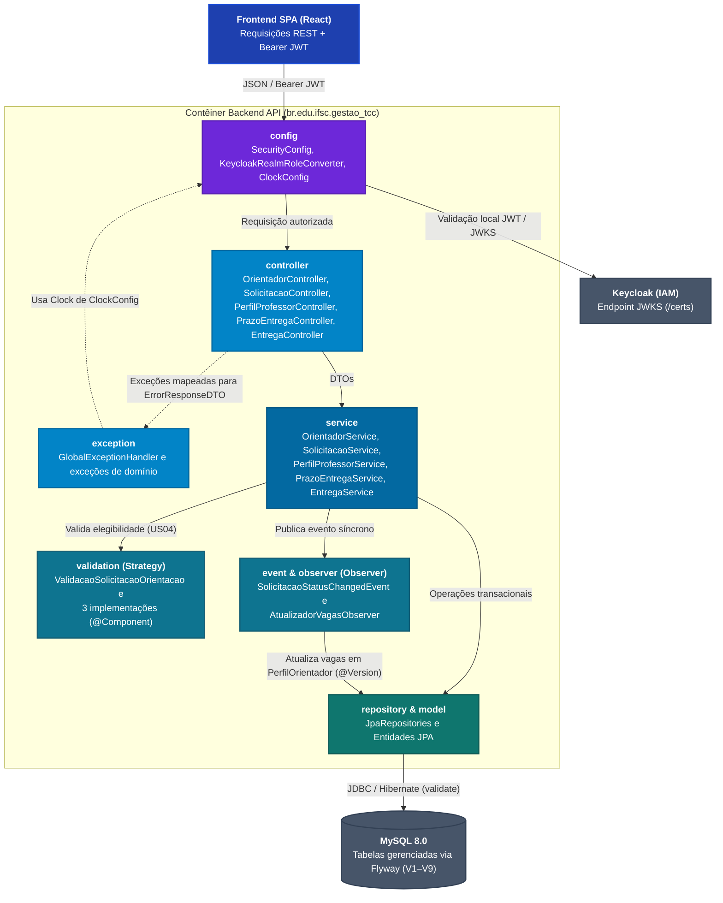

# Diagrama de Arquitetura: Visão de Componentes do Backend (C3)

Este documento apresenta a **Visão de Componentes (Nível 3 do modelo C4)** do contêiner **Backend API (Spring Boot 4.1.1 / Java 21)** do **SIGTCC**, detalhando os pacotes reais implementados no módulo `br.edu.ifsc.gestao_tcc` e suas interações.

> **Marco:** `v1.0.0-rc.1` (Entrega 9 – Release Candidate).

---

## 1. Diagrama de Componentes (C3)

---

## 2. Mapeamento de Pacotes e Classes Reais

| Pacote                              | Classes Principais                                                                                                                                                                      | Responsabilidade Arquitetural                                                                                              |
| :---------------------------------- | :-------------------------------------------------------------------------------------------------------------------------------------------------------------------------------------- | :------------------------------------------------------------------------------------------------------------------------- |
| `br.edu.ifsc.gestao_tcc.config`     | `SecurityConfig`, `KeycloakRealmRoleConverter`, `ClockConfig`                                                                                                                           | Resource Server OAuth2/JWT, regras de autorização por papel (`ROLE_ALUNO`, `ROLE_PROFESSOR`), CORS e `Clock` institucional |
| `br.edu.ifsc.gestao_tcc.controller` | `OrientadorController`, `SolicitacaoController`, `PerfilProfessorController`, `PrazoEntregaController`, `EntregaController`                                                             | Exposição dos endpoints REST `/api/v1/**`, validação de entrada (`@Valid`) e códigos HTTP                                  |
| `br.edu.ifsc.gestao_tcc.dto`        | `OrientadorRequestDTO`, `SolicitacaoRequestDTO`, `EntregaRequestDTO`, `ParecerRequestDTO`, `ErrorResponseDTO`, `ErroCampoDTO`, entre outros                                             | Contratos de entrada e saída da API REST, desacoplados das entidades JPA                                                   |
| `br.edu.ifsc.gestao_tcc.exception`  | `GlobalExceptionHandler`, `RegraDeNegocioException`, `AcessoNegadoException`, `ResourceNotFoundException`, `EmailDuplicadoException`, etc.                                              | Tratamento centralizado de exceções de validação, negócio, segurança, concorrência (`409`) e erros genéricos (`500`)       |
| `br.edu.ifsc.gestao_tcc.service`    | `OrientadorService`, `SolicitacaoService`, `PerfilProfessorService`, `PrazoEntregaService`, `EntregaService`                                                                            | Regras de negócio, controle de propriedade/vínculo e delimitação transacional (`@Transactional`)                           |
| `br.edu.ifsc.gestao_tcc.validation` | `ValidacaoSolicitacaoOrientacao`, `ValidacaoVagasDisponiveis`, `ValidacaoOrientadorAtivo`, `ValidacaoSolicitacaoDuplicada`                                                              | Padrão **Strategy** para validação polimórfica de elegibilidade de solicitações                                            |
| `br.edu.ifsc.gestao_tcc.event`      | `SolicitacaoStatusChangedEvent`                                                                                                                                                         | Record de evento de domínio emitido na mudança de status de uma solicitação                                                |
| `br.edu.ifsc.gestao_tcc.observer`   | `AtualizadorVagasObserver`                                                                                                                                                              | Padrão **Observer** (`@EventListener` síncrono) para decremento transacional de vagas                                      |
| `br.edu.ifsc.gestao_tcc.repository` | `UsuarioRepository`, `OrientadorRepository`, `AlunoRepository`, `SolicitacaoRepository`, `TurmaTCCRepository`, `PrazoEntregaRepository`, `EntregaRepository`, `ParecerRepository`, etc. | Persistência via Spring Data JPA e travas (`PESSIMISTIC_WRITE` em entregas/pareceres)                                      |
| `br.edu.ifsc.gestao_tcc.model`      | `Usuario`, `Orientador`, `PerfilOrientador` (`@Version`), `LinhaPesquisa`, `Aluno`, `SolicitacaoOrientacao`, `TurmaTCC`, `PrazoEntrega`, `Entrega`, `Parecer`                           | Modelo de domínio orientado a objetos mapeado para tabelas relacionais MySQL                                               |
